# Project 1 — Apigee OPDK ↔ Hybrid Traffic Management Load Balancer

## The Complete Project Guide

This guide covers the whole project: what it is, how every part fits together,
what each file and folder does, how requests and configuration changes flow, how
each claim is validated, which decisions were made and why, and an honest
evaluation of the result.

| | |
|---|---|
| **State described** | Milestones 1–3 complete (Milestone 3 uncommitted in the working tree) |
| **HAProxy version** | 3.0.31 (`haproxy:3.0-alpine`) |
| **Control plane** | Python 3.12, FastAPI 0.165, Pydantic 2.14, Uvicorn 0.54, SQLite |
| **Verified results** | 89/89 unit tests, 16/16 live integration tests, 9/9 Milestone 2 checks, 7/7 Milestone 2 offline tests |
| **Related docs** | [architecture.md](architecture.md) · [api-reference.md](api-reference.md) · [local-simulation.md](local-simulation.md) · [MILESTONE2.md](MILESTONE2.md) |

> Diagrams use Mermaid. They render on GitHub, GitLab and in VS Code's Markdown
> preview (with Mermaid support).

---

## Contents

1. [What this project is (and is not)](#1-what-this-project-is-and-is-not)
2. [The big picture](#2-the-big-picture)
3. [How the project evolved (milestones)](#3-how-the-project-evolved-milestones)
4. [Runtime topology: containers, networks, volumes, ports](#4-runtime-topology)
5. [Repository map: every folder and file](#5-repository-map)
6. [How it flows](#6-how-it-flows)
7. [Data model](#7-data-model)
8. [State machines](#8-state-machines)
9. [Inside the control plane: module dependencies](#9-inside-the-control-plane)
10. [Security model](#10-security-model)
11. [What validates it](#11-what-validates-it)
12. [Design decisions and why](#12-design-decisions-and-why)
13. [Evaluation](#13-evaluation)
14. [Recommended next steps](#14-recommended-next-steps)
15. [Glossary](#15-glossary)

---

## 1. What this project is (and is not)

**Problem.** An enterprise runs its APIs on **Apigee OPDK** (on-premises) and
wants to move to **Apigee Hybrid** (runtime on Kubernetes). Switching all
traffic at once is risky: new infrastructure, subtle proxy differences,
authentication or routing gaps, backend connectivity differences.

**Solution.** An independent **Layer 7 traffic layer** sits in front of both
gateway environments and shifts traffic **gradually** (100:0 → 90:10 → 75:25 →
50:50 → 0:100). It watches gateway health, removes unhealthy endpoints, and can
**roll back** at any step.

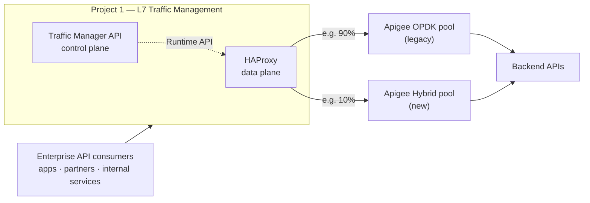

**What it is**
- A data plane (HAProxy) that does the actual routing.
- A control plane (FastAPI) that registers gateways, pools and instances, sets
  traffic policy, monitors health, keeps an audit trail, and rebuilds HAProxy's
  runtime state after restarts.

**What it is not**
- It does **not** migrate API proxies or deploy anything to Apigee.
- It does **not** prove OPDK and Hybrid behave identically. That needs separate
  functional validation.
- Locally it does **not** talk to real Apigee. Four small simulators stand in
  for gateway endpoints and are labeled as simulations everywhere.

---

## 2. The big picture

### 2.1 Data plane vs control plane

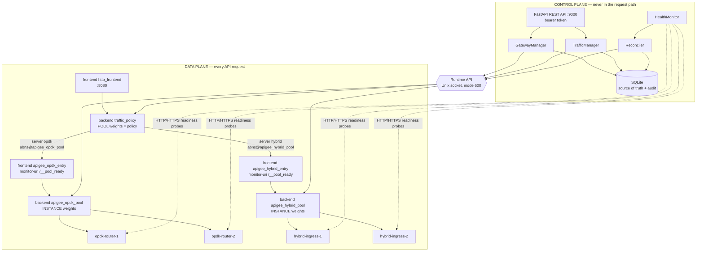

**Key idea:** if the control plane stops, HAProxy keeps routing with its last
runtime state. The control plane only changes HAProxy's runtime state, through
a private socket.

### 2.2 Why two tiers

The **pool split** (OPDK vs Hybrid) must stay what the operator chose, even
when individual instances fail. Each HAProxy tier answers one question:

| Tier | Question it answers | Mechanism |
|---|---|---|
| 1 `traffic_policy` | "Which platform gets this request?" | Two servers (`opdk`, `hybrid`) with policy weights (0–100, sum 100) |
| 2 `apigee_*_pool` | "Which instance of that platform?" | Instance servers with `lb_weight` (1–256) |

Worked example at 90:10 with two equal routers per pool:

| Situation | opdk-router-1 | opdk-router-2 | hybrid-ingress-1 | hybrid-ingress-2 |
|---|---:|---:|---:|---:|
| All healthy | 45% | 45% | 5% | 5% |
| opdk-router-2 unhealthy | **90%** | 0% | 5% | 5% |
| Both Hybrid instances unhealthy | 50% | 50% | 0% | 0% |

In the second row, OPDK keeps its 90% and the remaining router absorbs it. In
the third row the whole Hybrid pool **drops out** and OPDK takes 100%: its
pool-readiness check (`nbsrv == 0`) fails.

---

## 3. How the project evolved (milestones)

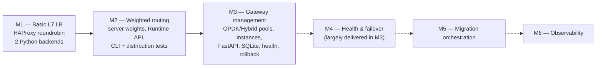

| Milestone | Delivered | Still used by M3? |
|---|---|---|
| **M1** | `docker-compose.yml`, `backend-a/`, `backend-b/`, `haproxy.cfg` (roundrobin) | Yes. The backends became the simulators; the ports are unchanged. |
| **M2** | Weights in HAProxy, admin Runtime API socket, `runtime/haproxy_runtime.py`, `set_weights.py`, `test_distribution.py`, `run_milestone2_tests.sh` | Yes. **The traffic manager reuses `haproxy_runtime.py`** for every policy-weight change. |
| **M3** | Two-tier HAProxy, `traffic-manager/` service, SQLite, health monitor, reconciler, docs | — |

The M3 health monitor, automatic removal and recovery, and policy rollback were
in the M3 specification, so parts of the roadmap's M4/M5 are already done (see
§14).

---

## 4. Runtime topology

### 4.1 Containers, ports, volumes

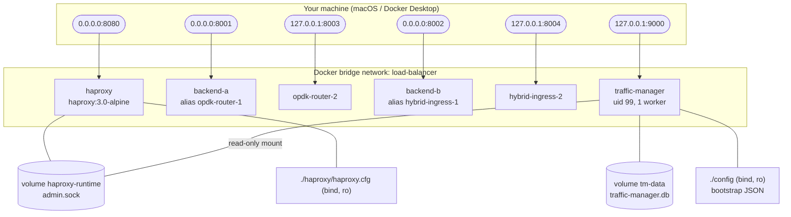

| Container | Image / build | Role | Host port | Why that binding |
|---|---|---|---|---|
| `haproxy` | `haproxy:3.0-alpine` | Data plane | `8080` (all interfaces) | The public entry point, unchanged since M1 |
| `backend-a` | `./backend-a` | OPDK router simulator #1 (`opdk-router-1`) | `8001` | Kept from M1 |
| `opdk-router-2` | `./backend-a` | OPDK router simulator #2 | `127.0.0.1:8003` | New; localhost only (only needed for test fault injection) |
| `backend-b` | `./backend-b` | Hybrid ingress simulator #1 (`hybrid-ingress-1`) | `8002` | Kept from M1 |
| `hybrid-ingress-2` | `./backend-b` | Hybrid ingress simulator #2 | `127.0.0.1:8004` | New; localhost only |
| `traffic-manager` | `traffic-manager/Dockerfile` (target `runtime`) | Control plane | `127.0.0.1:9000` | Admin API: never exposed beyond localhost |

| Volume | Mounted in | Contents | Why |
|---|---|---|---|
| `haproxy-runtime` | haproxy `/var/lib/haproxy` (rw), traffic-manager `/run/haproxy-runtime` (**ro**) | `admin.sock` | Share a Unix socket without any TCP listener. `connect()` works on read-only mounts. |
| `tm-data` | traffic-manager `/app/data` | `traffic-manager.db` (+ WAL files) | Persists across container rebuilds. `docker compose down -v` resets it. |

---

## 5. Repository map

### 5.1 Tree

```
load balancer/
├── loadbalancer                     ← stray empty file outside the repo (safe to delete)
└── load-balancer/                   ← git repository root
    ├── .dockerignore                build-context exclusions
    ├── .env                         (git-ignored) your TRAFFIC_API_TOKEN
    ├── .env.example                 template for .env
    ├── .gitignore                   ignores .env, .venv, caches
    ├── .venv/                       (git-ignored) host virtualenv for live tests
    ├── docker-compose.yml           all 6 services, network, volumes
    ├── haproxy/
    │   └── haproxy.cfg              data-plane configuration (two tiers)
    ├── backend-a/                   OPDK simulator image
    │   ├── Dockerfile
    │   └── app.py
    ├── backend-b/                   Hybrid simulator image
    │   ├── Dockerfile
    │   └── app.py
    ├── config/
    │   └── bootstrap.simulation.json  first-start import (platforms, pools, instances, policy)
    ├── runtime/                     Milestone 2 Runtime API toolkit (reused by M3)
    │   ├── haproxy_runtime.py
    │   ├── set_weights.py
    │   └── test_haproxy_runtime.py
    ├── traffic-generator/           traffic measurement tools
    │   ├── test_distribution.py
    │   └── run_milestone2_tests.sh
    ├── traffic-manager/             Milestone 3 control plane
    │   ├── Dockerfile               runtime + test stages
    │   ├── requirements.txt
    │   ├── requirements-dev.txt
    │   ├── pytest.ini
    │   ├── app/
    │   │   ├── main.py              app factory, control loop, error handlers
    │   │   ├── settings.py          env-driven configuration
    │   │   ├── security.py          bearer auth, actor attribution
    │   │   ├── errors.py            service errors → HTTP codes
    │   │   ├── bootstrap.py         first-start import
    │   │   ├── api/                 REST routers
    │   │   │   ├── gateways.py
    │   │   │   ├── pools.py
    │   │   │   ├── instances.py
    │   │   │   ├── traffic.py
    │   │   │   └── health.py
    │   │   ├── models/              Pydantic schemas + validators
    │   │   │   ├── common.py
    │   │   │   ├── gateway.py
    │   │   │   ├── pool.py
    │   │   │   ├── instance.py
    │   │   │   └── traffic_policy.py
    │   │   ├── services/            business logic
    │   │   │   ├── haproxy_client.py
    │   │   │   ├── gateway_manager.py
    │   │   │   ├── traffic_manager.py
    │   │   │   ├── health_monitor.py
    │   │   │   ├── reconciler.py
    │   │   │   ├── audit_service.py
    │   │   │   └── control.py
    │   │   └── database/
    │   │       ├── connection.py    SQLite wrapper + migration runner
    │   │       └── migrations/
    │   │           └── 0001_initial.sql
    │   ├── tests/                   89 unit tests (run in Docker)
    │   │   ├── conftest.py
    │   │   ├── test_gateways.py
    │   │   ├── test_traffic.py
    │   │   ├── test_health.py
    │   │   ├── test_instances.py
    │   │   ├── test_persistence.py
    │   │   ├── test_failures.py
    │   │   └── test_security.py
    │   └── tests_integration/
    │       └── test_live.py         16 live tests against the running stack
    └── docs/
        ├── PROJECT_GUIDE.md         this document
        ├── architecture.md          architecture reference
        ├── api-reference.md         endpoint reference
        ├── local-simulation.md      run/test/troubleshoot guide
        └── MILESTONE2.md            Milestone 2 documentation
```

The `__init__.py` files in `app/` and its subpackages are empty package markers.

### 5.2 Repository root files

| File | What it does | Why it exists / notes |
|---|---|---|
| `docker-compose.yml` | Defines 6 services, the `load-balancer` bridge network and 2 named volumes. YAML anchors (`x-opdk-sim`, `x-hybrid-sim`) remove duplication between simulator instances. Passes health and TLS settings from `.env` to the containers. | Single command to run the whole system. Keeps M1 service names and ports so nothing that used them breaks. |
| `.env` *(ignored)* | Holds `TRAFFIC_API_TOKEN` (generated with `openssl rand -hex 32`, mode 600). | Secrets stay out of git and out of the compose file. |
| `.env.example` | Template listing the required token and all optional overrides. | Documents configuration without leaking secrets. |
| `.gitignore` | Ignores `.env`, `.venv/`, Python caches. | Prevents committing secrets or local tooling. |
| `.dockerignore` | Excludes `.git`, `.venv`, `.env`, caches and docs from the build context. | The traffic-manager image builds from the repo root (to reuse `runtime/`). This keeps the context small and keeps secrets out of images. |

### 5.3 `haproxy/haproxy.cfg` — the data plane

| Section | What it does | Why |
|---|---|---|
| `global` → `stats socket /var/lib/haproxy/admin.sock mode 600 level admin` | Opens the Runtime API as a Unix socket that only uid 99 can use. | Runtime changes without restarts; no network exposure. |
| `defaults` | HTTP mode, logging, 5 s connect and 50 s client/server timeouts. | Unchanged from M1. |
| `frontend http_frontend` | `bind *:8080`, routes everything to `traffic_policy`. | Public entry point, unchanged. |
| `backend traffic_policy` | `balance roundrobin`; `server opdk abns@apigee_opdk_pool weight 100 check inter 1s fall 2 rise 1`, `server hybrid … weight 0`; `option httpchk GET /__pool_ready`. | Tier 1: the policy split. The boot weights 100:0 are the safe baseline. |
| `frontend apigee_*_entry` | `bind abns@…`; `monitor-uri /__pool_ready`; `monitor fail if { nbsrv(pool) eq 0 }`. | Lets tier 1 know whether a pool has any usable server. |
| `backend apigee_opdk_pool`, `apigee_hybrid_pool` | `balance roundrobin`; native HTTP check at `${OPDK_NATIVE_CHECK_PATH}` / `${HYBRID_NATIVE_CHECK_PATH}` expecting 200. **No servers listed.** | Tier 2. Servers are added at runtime by the traffic manager from SQLite. The native check is a fast safety net. |

### 5.4 `backend-a/` and `backend-b/` — gateway simulators

| File | What it does |
|---|---|
| `app.py` | Standard-library `ThreadingHTTPServer`. Any `GET` returns JSON with `backend` (the M1/M2 label), `platform` (`APIGEE_OPDK`/`APIGEE_HYBRID`), `instance`, `role`, `"simulated": true`, `hostname`, `path`. `GET /healthz` (readiness) returns 200, or 503 when switched off. `GET/POST /__sim/health` reads or toggles readiness (simulation-only fault injection). Configured with `BACKEND_LABEL`, `SIM_PLATFORM`, `SIM_INSTANCE`, `SIM_ROLE`, `SIM_HEALTH_PATH`. |
| `Dockerfile` | `python:3.12-slim`, copies `app.py`, runs it on port 8000. |

The two `app.py` files are identical except for default labels, so each image
works standalone. The fault switch exists because a simulator that only
"refuses TCP" can't demonstrate the central health-check lesson: **an open port
is not readiness**.

### 5.5 `config/bootstrap.simulation.json`

Declares two platforms (both described as *LOCAL SIMULATION … Not Apigee*), two
pools, four instances (hostnames = Docker aliases, port 8000, `/healthz`,
`[200]`) and the initial policy 100:0. It is imported **only into an empty
database**, so it never overwrites live configuration. To use real endpoints,
point `BOOTSTRAP_FILE` at another file or register through the API.

### 5.6 `runtime/` — Milestone 2 Runtime API toolkit

| File | What it does | Used by |
|---|---|---|
| `haproxy_runtime.py` | Core library. `validate_weights` (ints 0–256, sum > 0). Exception types `RuntimeAPIError`, `RuntimeAPIConnectionError`, `WeightUpdateError` (with `rolled_back`, `previous`, `cause`), `WeightValidationError`. `docker_exec_transport` (talks to the socket through `docker exec haproxy socat`). `HAProxyRuntime.set_weights`: preflight read, **increases first**, read-back verify, roll back on failure. Defaults now target `traffic_policy` / `opdk` / `hybrid`. | `set_weights.py`, `test_distribution.py`, and **the traffic manager** (copied into its image at `/app/lib`) |
| `set_weights.py` | Operator CLI: `--show`, `--a/--b`, `--scenario canary-2`, `--list-scenarios`. Exit codes 0 / 1 (runtime error) / 2 (invalid input). | Humans, M2 test script. It bypasses SQLite, so changes appear as drift in M3. |
| `test_haproxy_runtime.py` | 7 offline `unittest` tests against a fake socket: validation, increase-first ordering, rollback, unknown server. Uses explicit M2 names so it doesn't depend on the defaults. | `run_milestone2_tests.sh` |

### 5.7 `traffic-generator/`

| File | What it does |
|---|---|
| `test_distribution.py` | Sends N requests to `:8080`, **each on a new TCP connection with `Connection: close`**, from a thread pool. Classifies each response by `platform` (falling back to `backend`), counts per pool **and per instance**, compares with expected weights, and reports PASS/FAIL within a tolerance (0% and 100% are checked exactly). `--apply` sets the weights first through the Runtime API. Exposes `request_detail` and `run_traffic_detailed`, which the live tests reuse. |
| `run_milestone2_tests.sh` | M2 acceptance script: M1 endpoint pre-check, offline unit tests, the six distributions, live change with no restart (compares the container start time and HAProxy PID), and invalid-input rejection. |

### 5.8 `traffic-manager/` — Milestone 3 control plane

#### Build and test configuration

| File | What it does |
|---|---|
| `Dockerfile` | **Stage `runtime`:** `python:3.12-slim`, installs requirements, creates user/group **uid/gid 99** (the same uid as HAProxy's `haproxy` user, so it can open the mode-600 socket), copies `runtime/haproxy_runtime.py` to `/app/lib` and `app/` to `/app/app`, runs `uvicorn --factory app.main:create_app --workers 1`. **Stage `test`:** adds `openssl` (for the HTTPS probe test), dev requirements and tests; default command runs pytest. |
| `requirements.txt` | `fastapi`, `uvicorn`, `pydantic` (pinned). Nothing else: SQLite, HTTP probes and TLS all use the standard library. |
| `requirements-dev.txt` | `pytest`, `httpx` (for FastAPI's `TestClient`). |
| `pytest.ini` | `testpaths = tests`, registers the `integration` marker, disables the cache (read-only image), filters a third-party deprecation warning. |

#### `app/` top level

| File | What it does | Why it is designed this way |
|---|---|---|
| `main.py` | `create_app()` factory. Wires the database, HAProxy client, audit, lock, managers, reconciler and monitor. The **lifespan** runs migrations, the bootstrap, one synchronous reconcile, then starts the `ControlLoop` thread (probe → transitions → reconcile every interval, or immediately when woken by an API change). Registers error handlers; a 422 on `PUT /traffic/config` is audited as `REJECTED`. Holds the OpenAPI description. | A factory with injectable `transport`, `resolver` and `prober` makes the whole app testable against fakes. The startup reconcile satisfies "reconcile with HAProxy when the service starts". |
| `settings.py` | Frozen `Settings` dataclass loaded from env. **Refuses to start** without a token of at least 16 characters, or with invalid thresholds. Holds intervals, thresholds, timeouts, CA paths and pool hold/release timings. | Fail closed. One typed place for every knob. |
| `security.py` | `require_admin` dependency: 401 if there is no bearer token, 403 if it is wrong (`hmac.compare_digest`). `actor()` builds the audit source `api:<ip> (actor=<X-Actor>)` with the header sanitized. | Simple, standard, testable. The POC limitations are documented. |
| `errors.py` | `ServiceError` hierarchy with HTTP status and machine code: `NotFound` 404, `Conflict` 409, `PoolNotEligible` 409, `InvalidRequest` 422, `HAProxyUnavailable` 503, `Busy` 503, `HAProxyUpdateFailed` 502, `InconsistentState` 500, `PersistenceFailed` 500. | Callers get distinct, actionable failure modes. "HAProxy said no and we rolled back" (502) is different from "we don't know the state" (500). |
| `bootstrap.py` | Validates the bootstrap JSON with Pydantic and creates everything in **one SQLite transaction** (all or nothing). Writes the DB only; the reconciler pushes to HAProxy. Records a `BOOTSTRAP` audit event. | Zero-touch local start without hardcoding endpoints in code. |

#### `app/api/` — REST routers (thin; no business logic)

| File | Endpoints |
|---|---|
| `gateways.py` | `GET/POST /api/v1/gateways`, `GET /api/v1/gateways/{id}` |
| `pools.py` | `GET/POST /api/v1/pools`, `GET /api/v1/pools/{id}` (with health summary) |
| `instances.py` | `POST/GET /api/v1/instances`, `GET/PATCH/DELETE /api/v1/instances/{id}` (`force`, `reason` query parameters) |
| `traffic.py` | `GET/PUT /api/v1/traffic/config`, `POST /api/v1/traffic/rollback`, `GET /api/v1/traffic/history`, `GET /api/v1/traffic/policies` |
| `health.py` | Public `GET /livez`. Authenticated `GET /api/v1/health`, `/health/gateways`, `/health/instances`, `/api/v1/audit` |

Every `/api/v1` router has `dependencies=[Depends(require_admin)]` at router
level, so a new endpoint can't accidentally be left public. Each documents its
error responses for Swagger.

#### `app/models/` — schemas and validation

| File | What it does |
|---|---|
| `common.py` | Enums (`PlatformType`, `HealthStatus`), HAProxy name constants (`POLICY_BACKEND`, `POLICY_SERVER`, `POOL_BACKEND`), and **allow-list validators** for server names, display names, hosts (DNS or IPv4), Host headers, health paths and status codes. `StrictModel` (`extra="forbid"`), `ErrorResponse`. |
| `gateway.py` | `GatewayPlatformCreate`, `GatewayPlatform` |
| `pool.py` | `GatewayPoolCreate`, `PoolHealthSummary`, `GatewayPool` |
| `instance.py` | `GatewayInstanceCreate` (all fields, defaults, `tls_server_name` only valid for HTTPS), `GatewayInstanceUpdate` (partial; `pool_id` deliberately absent), `InstanceRuntime`, `GatewayInstance` |
| `traffic_policy.py` | `TrafficPolicyUpdate` (strict ints 0–100, *both zero* gets its own message, sum must be 100), `RollbackRequest`, `TrafficPolicy`, `TrafficConfig`, `TrafficChangeResult`, `AuditEntry`, `AuditPage` |

**Strict integers** (`strict=True`) reject `"90"`, `90.0`, `90.5` and `true`.
Weights are operational settings, so silent coercion would hide client bugs.

#### `app/services/` — the logic

| File | What it does |
|---|---|
| `haproxy_client.py` | `unix_socket_transport` (one command per connection; errors never expose the socket path). `HAProxyClient`: strict parsers for `show servers state`, `show stat` and `show info` (malformed replies raise); `policy_weights()` / `set_policy_weights()` delegate to the **M2 `HAProxyRuntime`**; `add_server` (adds in MAINT, `enable health`, verifies, compensates with `del server` on failure); `set_state`, `set_weight`, `set_addr` (each verified by read-back); `delete_server` (drain → wait for sessions → maint → shutdown sessions → del → verify gone). **Refuses any command containing `;`, CR or LF.** |
| `gateway_manager.py` | Platform and pool CRUD. Instance register / update / deregister in SQLite **and** HAProxy, with the DB transaction wrapping the runtime call so a runtime failure rolls the DB back. Runtime snapshots and per-instance runtime views. Pool health summary. `is_routable` (enabled ∧ HEALTHY ∧ READY ∧ UP). **Last-routable-instance safety check** (409 unless `force`). Connection changes replace the server and reset health. |
| `traffic_manager.py` | The **policy transaction** (§6.3): eligibility, M2 apply/verify/rollback, then one DB transaction that versions the policy, mirrors pool weights and writes the audit record, with runtime compensation if the DB fails. Rollback, history, versions, `seed_policy` (bootstrap), `restore_runtime` (reconciler). |
| `health_monitor.py` | `Prober`: HTTP/HTTPS probe to the **resolved IP**, custom Host header, SNI, TLS verify (system CA plus optional `PROBE_CA_FILE`) or explicit opt-out, expected status codes, latency. `HealthMonitor.run_cycle`: parallel probes outside the lock, state machine updates under the lock, then a reconcile. Stale results are discarded if the instance changed meanwhile. |
| `reconciler.py` | Makes HAProxy match SQLite: re-adds missing instances (MAINT), fixes address and weight drift, removes unregistered servers, enforces READY/MAINT, restores the policy on start, HAProxy restart, or failed compensation, and runs **pool hold/release** after HAProxy (re)starts. |
| `audit_service.py` | Inserts audit rows (joins the caller's transaction so a change and its audit record commit together). Clips long text. Lists entries with filters, chronologically, paginated. Defines event-type constants. |
| `control.py` | `ControlLock` (re-entrant, bounded wait → 503). `Resolver` (hostname → lowest IPv4; needed because HAProxy 3.0 dynamic servers can't use DNS). |

#### `app/database/`

| File | What it does |
|---|---|
| `connection.py` | `Database`: one connection guarded by an RLock; WAL, `foreign_keys=ON`, `synchronous=FULL`, `busy_timeout`. `transaction()` uses `BEGIN IMMEDIATE`, and nested calls join the outer one. **Migration runner**: applies `NNNN_name.sql` files in order, each in one transaction, recorded in `schema_migrations`. `utcnow()` for UTC ISO timestamps. |
| `migrations/0001_initial.sql` | Five tables with **database-level constraints that back up API validation**: one platform per type, one pool per platform, weights 0–100 summing to 100, `CHECK`s on enums, a partial unique index guaranteeing exactly one active policy, and audit indexes. |

#### `tests/` and `tests_integration/`

| File | Tests | Focus |
|---|---:|---|
| `conftest.py` | — | `FakeHAProxy` (emulates `show servers state`/`stat`/`info`, `add/del server`, `set server weight/state/addr`, `enable health`, the per-pool readiness link, restarts, injected failures, disconnects), `FakeResolver`, `FakeProber`, `Env` (fresh app "processes" on one DB), `seed()`, `cycle()` |
| `test_gateways.py` | 7 | Spec tests 1–4; injection-proof validation; HTTPS/SNI command; unresolvable host |
| `test_traffic.py` | 21 | Spec tests 5–8, 15, 17; eligibility; rollback edge cases; lock contention → 503 |
| `test_health.py` | 9 | Spec tests 9–11; whole pool down; recovery hold-down; never enabling a failing new instance; native check; **real HTTP and HTTPS probes** (self-signed cert, SNI, CA, opt-out) |
| `test_instances.py` | 7 | Spec test 12; last-routable safety; PATCH semantics; address drift; orphan removal |
| `test_persistence.py` | 9 | Spec test 13; HAProxy restart recovery; no accidental re-enabling; migrations and DB constraints; bootstrap; **pool hold/release** |
| `test_failures.py` | 10 | Spec test 14; unreachable HAProxy; mid-update rejection; connection lost mid-update then repaired; DB failure compensation; malformed replies; injection guard |
| `test_security.py` | 26 | Spec test 16 across all 20 endpoints (401/403/Basic); auth before validation; public endpoints; startup refusal; no socket-path leaks |
| `tests_integration/test_live.py` | 16 | The real stack: bootstrap state; **six 10,000-request distributions**; live health removal and recovery; eligibility; register/deregister; invalid and unauthorized; concurrency; rollback; API restart; **HAProxy restart under load**; HAProxy down |

### 5.9 `docs/`

| File | Audience / content |
|---|---|
| `PROJECT_GUIDE.md` | This end-to-end guide |
| `architecture.md` | Architecture reference: tiers, transactions, lifecycle, reconciliation, security, limitations |
| `api-reference.md` | Every endpoint, field, error code and env variable |
| `local-simulation.md` | Running locally, swapping in real endpoints, test commands and results, troubleshooting |
| `MILESTONE2.md` | Milestone 2 (with a note on the M3 renames) |

---

## 6. How it flows

### 6.1 An API request (data plane)

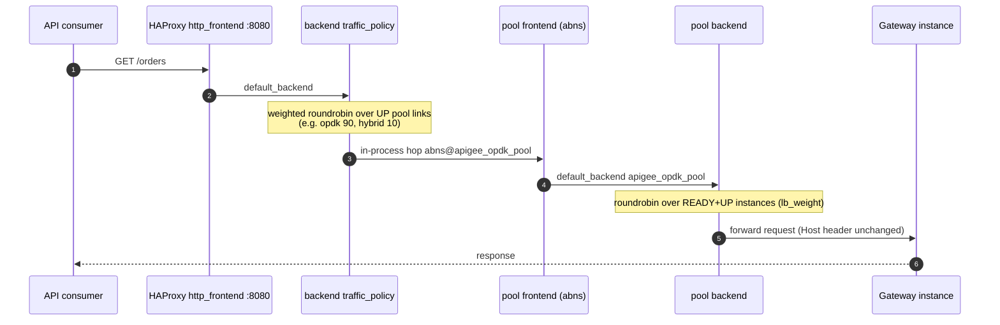

The traffic manager is **not involved**. Each request costs one extra
in-process hop (an abstract Unix socket inside HAProxy) and no network hop.

### 6.2 Startup

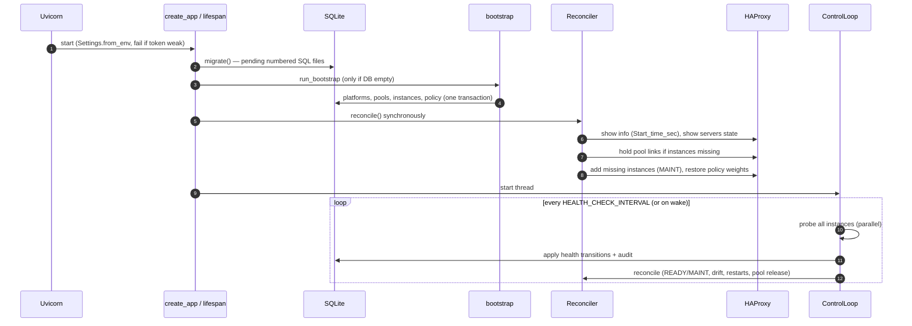

### 6.3 Changing the traffic policy

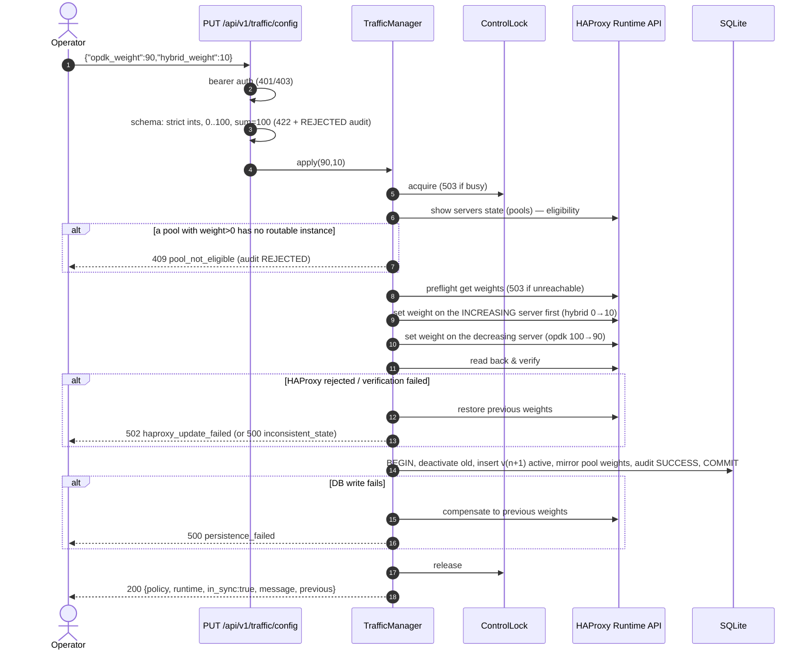

### 6.4 Registering an instance

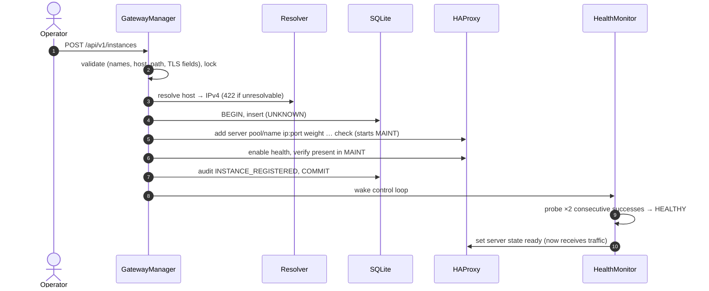

### 6.5 Health failure and recovery

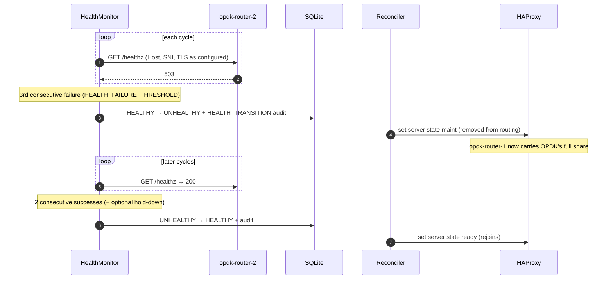

### 6.6 Safe deregistration

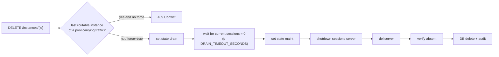

### 6.7 HAProxy restart recovery (with pool hold)

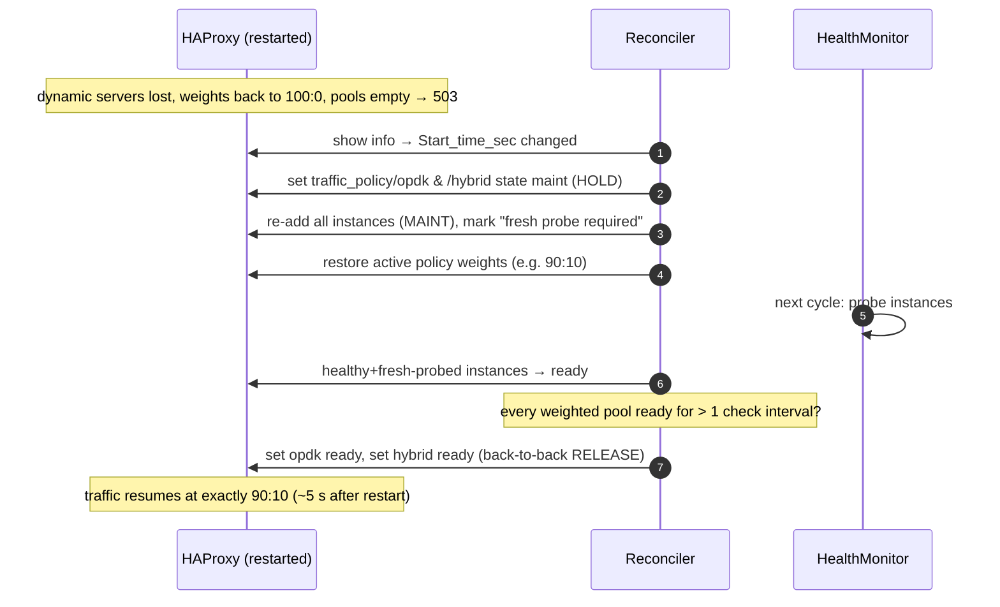

Without the hold, each pool link's 1-second readiness check passes at a
different moment, and the first pool back would briefly take **100%** of
traffic. This was observed in live testing before the fix, when a 10% canary
took everything. After the fix, Hybrid received 9.98% of the requests served
during a restart under load.

---

## 7. Data model

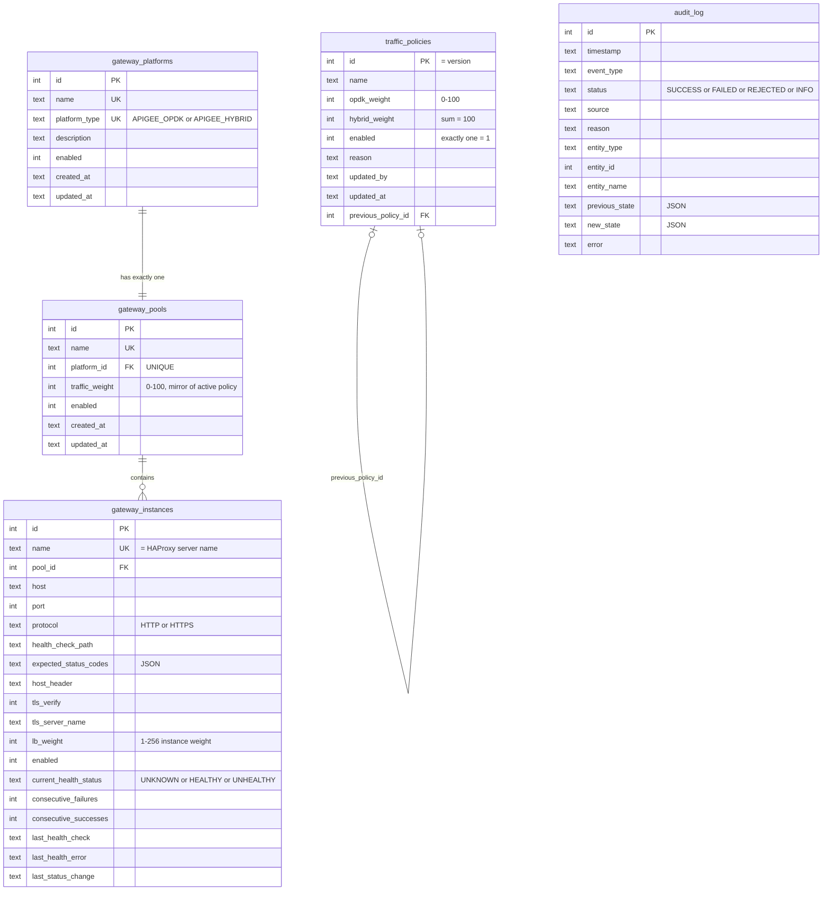

**Sources of truth**

| Fact | Source of truth | Mirror |
|---|---|---|
| Which instances exist, and their configuration | SQLite | HAProxy dynamic servers |
| Desired traffic split | SQLite (active policy) | HAProxy `traffic_policy` weights |
| Observed health | SQLite (monitor) | HAProxy admin state READY/MAINT |
| What actually routes *now* | **HAProxy runtime** (always read live) | — |

---

## 8. State machines

### 8.1 Instance health (monitor)

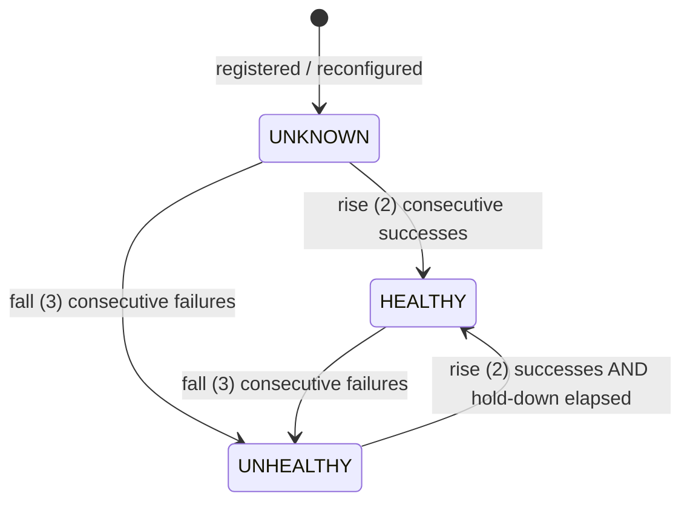

### 8.2 Instance routing (HAProxy admin state, set by the reconciler)

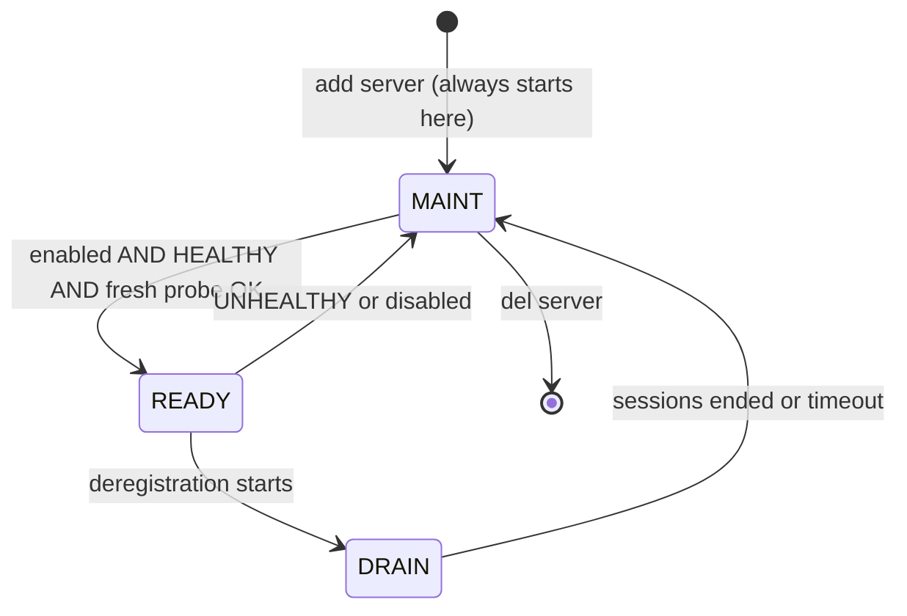

An instance **receives traffic** only when READY **and** UP in HAProxy's own
native check, **and** its pool's link is UP **and** the pool's policy weight is
above 0.

### 8.3 Pool links after an HAProxy (re)start

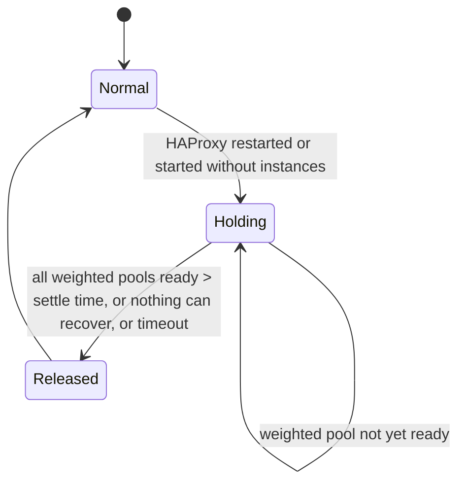

---

## 9. Inside the control plane

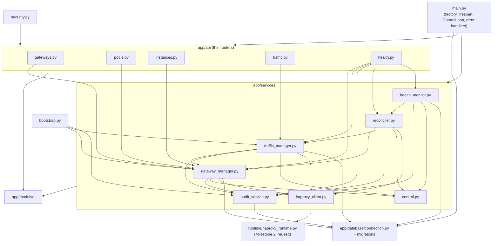

**Layering rules followed**
- Routers only translate HTTP into service calls.
- Services own the rules and transactions.
- `haproxy_client.py` is the only module that talks to HAProxy, and
  `connection.py` the only one that talks to SQLite.
- One shared `ControlLock` serializes every mutation.

---

## 10. Security model

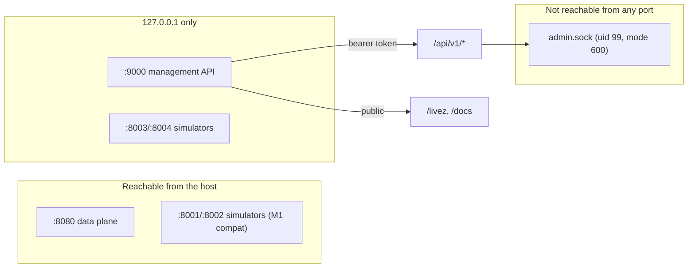

| Threat | Control |
|---|---|
| Unauthorized config changes | Bearer token on every `/api/v1` route (router-level), 401/403, constant-time compare, refusal to start without a strong token |
| Exposed Runtime API | Unix socket only; mode 600; uid 99; mounted only into the traffic manager, read-only; no TCP listener |
| Command injection into the Runtime API | Allow-list validators on all names, hosts and SNI; client refuses `;` / CR / LF; IPv4-only addresses for dynamic servers |
| Information leakage | Socket path only in server logs; generic "unreachable" messages; `/livez` reveals nothing; audit text clipped |
| Secrets in source | Token from env (`.env` git-ignored, excluded from build context); CA bundles referenced by path |
| Accidental outage by operator | Eligibility check (409), last-routable-instance check (409 unless `force`), rejected input is audited |
| Weak TLS to gateways | `ssl verify required` with a CA by default; `verify none` only via explicit `tls_verify: false` |

**POC limitations (deliberate):** one shared token with no identities, scopes,
rotation or expiry; `X-Actor` is unverified; no TLS on `:9000`; the M1
simulator ports stay on all interfaces for backward compatibility.

---

## 11. What validates it

### 11.1 Test pyramid

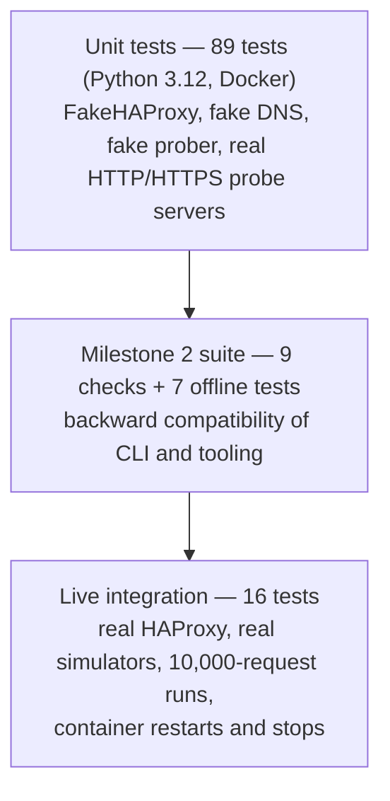

### 11.2 Requirement → evidence matrix

| Requirement / claim | Unit evidence | Live evidence | Result |
|---|---|---|---|
| Register OPDK and Hybrid platforms | `test_1_*`, `test_2_*` | `test_bootstrapped_gateways` | ✅ |
| Pools, multiple instances | `test_3_*`, `test_4_*` | `test_bootstrapped_gateways` | ✅ |
| Policy updates via API, no HAProxy restart | `test_5_*`, `test_8_*` | 6 distribution tests (StartedAt unchanged) | ✅ |
| Invalid percentages / both zero rejected | `test_6_*` (12 cases), `test_7_*` | `test_invalid_and_unauthorized` | ✅ |
| Weighted routing accuracy | — | 100:0, 90:10, 75:25, 50:50, 25:75, 0:100 × 10,000 | ✅ within ±1 request |
| Unhealthy instance removed / recovered | `test_9_*`–`test_11_*` | `test_health_failure_removal_and_recovery` | ✅ |
| Safe deregistration, no traffic after | `test_12_*` | `test_register_and_deregister_instance` | ✅ |
| Persistence across API restart | `test_13_*` | `test_persistence_after_management_api_restart` | ✅ |
| Recovery after HAProxy restart | `test_haproxy_restart_recovery`, pool-hold tests | `test_haproxy_restart_recovery` (under load) | ✅ |
| Failed Runtime API updates handled | `test_14_*` + 5 more | `test_runtime_api_unreachable` | ✅ |
| Rollback | `test_15_*` + 2 more | `test_rollback` | ✅ |
| Unauthorized requests | `test_16_*` × 20 endpoints | `test_invalid_and_unauthorized` | ✅ |
| Concurrent updates consistent | `test_17_*` (19 threads, version chain) | `test_concurrent_updates` (10 threads) | ✅ |
| No accidental re-enabling | `test_unhealthy_and_disabled_not_reenabled…`, mid-hold restart | — | ✅ |
| HTTPS probes, SNI, CA verification | `test_https_probe_tls_verify_and_sni` | — (simulators are HTTP) | ✅ unit only |
| M1/M2 still work | — | `run_milestone2_tests.sh` 9/9; M1 endpoints | ✅ |

### 11.3 Measured distribution (10,000 requests each, new connection per request)

| Policy | OPDK exp/obs | Hybrid exp/obs | Tolerance | Result |
|---|---|---|---|---|
| 100:0 | 10000 / 10000 | 0 / 0 | exact | PASS |
| 90:10 | 9000 / 9001 | 1000 / 999 | ±0.99 pp | PASS |
| 75:25 | 7500 / 7501 | 2500 / 2499 | ±1.42 pp | PASS |
| 50:50 | 5000 / 5000 | 5000 / 5000 | ±1.65 pp | PASS |
| 25:75 | 2500 / 2499 | 7500 / 7501 | ±1.42 pp | PASS |
| 0:100 | 0 / 0 | 10000 / 10000 | exact | PASS |

**Why the tolerance is what it is.** For an *independent random* splitter, the
observed share has standard deviation √(p(1−p)/n). Using ±3.29σ (99.9%
two-sided) gives the column above. HAProxy's `roundrobin` is **deterministic**
smooth weighted round-robin, so the only deviation is where in the cycle a test
starts (±1 request). The tolerance is a ceiling; the system stays far inside it.

### 11.4 Other measurements

| Measurement | Value |
|---|---|
| Outage after HAProxy restart until traffic stable | 4.8–5.1 s (3 runs, 2 s loop) |
| Canary share served during HAProxy restart under load at 90:10 | 9.98% |
| Throughput of the test client (Docker Desktop, macOS) | ~1,500–2,400 req/s with fresh connections |

### 11.5 How a real bug was found

The first live run of the HAProxy-restart test failed: after a restart the
split was ~55:45 instead of 90:10. Step-by-step tracing ruled out HAProxy's
round-robin (bouncing a server returned exactly 10%) and isolated the cause:
the two pool links became ready **up to a second apart**, and the first one
back took all traffic. The fix (pool hold/release, §6.7) was implemented,
unit-tested (3 new tests, including a management-API restart mid-hold), and the
live test was strengthened to sample traffic **during** the restart, so it
guards against regressions.

---

## 12. Design decisions and why

Each decision lists the alternatives considered and its cost.

| # | Decision | Alternatives | Why this choice | Cost / trade-off |
|---|---|---|---|---|
| D1 | **HAProxy** as data plane | NGINX, Envoy, a custom proxy | Mature L7 proxy, native weighted round-robin, full Runtime API (weights, states, dynamic servers) with no reloads | HAProxy-specific runtime commands |
| D2 | **Change runtime state, never reload** for policy changes | Re-render config + reload | No connection disruption; immediate effect; matches the "no restart" requirement | Runtime state is volatile, so a reconciler is required (D9) |
| D3 | **Two tiers** (policy backend → pool backends via `abns@`) | One flat backend with computed per-instance weights; `use_backend` + `rand()` + runtime maps | Keeps pool share independent of instance failures; deterministic split; pool-level failover through `nbsrv` | One extra in-process hop; more config |
| D4 | **`roundrobin`** (dynamic weighted RR) | `static-rr`, `leastconn`, random | Only dynamic algorithm with exact, predictable weighted shares that accepts runtime weights | Not load-aware (fine for share-based migration) |
| D5 | Policy weights are **integers 0–100 summing to 100** | M2's 0–256 relative weights | Operators think in percent; one obvious representation; DB-enforced | Coarsest step is 1% |
| D6 | **Increase first, then decrease, verify, compensate** (reused from M2) | Two independent commands; config reload | The Runtime API has no multi-server transaction. This order keeps every intermediate state valid (never 0:0). | Brief mixed state for a few ms (always valid) |
| D7 | **Unix socket on a shared volume, uid 99, read-only mount** | TCP stats socket on the Docker network; `docker exec` from the API container | No network exposure; simulators can't reach it; no Docker socket in the API container | Both containers must agree on uid 99 |
| D8 | **Instances as dynamic servers** (`add server`), SQLite as truth | Static servers in `haproxy.cfg`; `server-template` slots | Registration through the API without editing config; no slot limits; deregistered instances can't reappear | They vanish on HAProxy restart → ~5 s 503 window, and the data plane depends on the control plane to recover |
| D9 | **Reconciler** (desired state in SQLite → HAProxy every cycle) | Imperative updates only | Self-healing after restarts, partial failures, IP changes, out-of-band server edits | More moving parts; periodic Runtime API reads |
| D10 | **Control plane resolves DNS** to IPv4 and refreshes it | HAProxy `resolvers` | HAProxy 3.0 rejects `resolvers` on dynamic servers (verified by probe) | No IPv6 yet; resolution lag up to one cycle |
| D11 | **Boot policy 100:0 (OPDK)** | 50:50 (M1 behavior) | Safe migration baseline: nothing goes to the new platform until an operator decides | M1's A/B alternation is no longer the default |
| D12 | **Management monitor is the readiness authority; HAProxy native check is the safety net** | HAProxy checks only; monitor only | Per-instance path, codes, Host header, SNI need the monitor; native checks react faster to hard failures | Two health signals to understand (documented in §8) |
| D13 | **Thresholds: fall 3, rise 2, optional hold-down** | Single-probe decisions | Avoids flapping; tunable per environment | Detection latency ≈ 3 × interval |
| D14 | **Fresh probe required** after re-add or service restart | Trust the stored HEALTHY status | "Unhealthy instances must not be accidentally re-enabled" | One extra cycle before traffic resumes |
| D15 | **Pool hold/release after HAProxy (re)start** | Faster selector checks; accept the race | Eliminates the transient 100% shift to one pool (found in testing) | Adds ~1.5 s settle to restart recovery |
| D16 | **Eligibility check** (409 if a weighted pool has no routable instance) | Allow and let traffic 503 | Prevents operators from sending traffic into a dead pool | Can't pre-stage weight onto an empty pool (by design) |
| D17 | **Last-routable-instance protection** (409 unless `force`) | Always allow | Prevents self-inflicted outages during maintenance | One extra flag for intentional shutdowns |
| D18 | **Versioned policies; rollback = new version; toggle default** | Undo stack; overwrite in place | History is never rewritten; audit is complete; "rollback twice = back where you were" is predictable | Many versions over time |
| D19 | **Out-of-band policy drift is reported, not reverted** (except after an HAProxy restart) | Always revert to SQLite | Doesn't fight an operator in an emergency; M2 CLI keeps working | Runtime and DB can diverge until someone acts (`in_sync:false`) |
| D20 | **SQLite + standard-library migrations** | PostgreSQL; SQLAlchemy + Alembic | Zero new dependencies; one file; transactional; enough for one control-plane instance | Single writer; no HA control plane |
| D21 | **One re-entrant control lock, one worker** | Fine-grained locks; distributed lock | Simple, provably serialized mutations (validated by the version-chain test) | No horizontal scaling of the API |
| D22 | **Strict validation + DB constraints** (defense in depth) | Coerce types; validate in one layer | Operational config must be exact; injection-proof | Clients must send real JSON integers |
| D23 | **Single bearer token, `/livez` public, everything else authenticated** | No auth; OAuth/OIDC | Meets the "no public management endpoints" rule without an identity system (out of scope) | No per-user identity |
| D24 | **Simulators keep the `backend` field and M1 ports** | New simulator images | M1 and M2 tools and tests keep working unmodified | Two near-identical `app.py` files |
| D25 | **Bootstrap file, applied only to an empty DB** | Hardcoded seeding; seed script | Zero-touch local start; real endpoints by swapping a file, not code | Changes to the file after first start are ignored (by design) |
| D26 | **One platform per type, one pool per platform** | N pools per platform | Matches the two HAProxy pool backends and the OPDK/Hybrid policy | Adding Kong or NGINX needs schema, config and policy generalization |
| D27 | **Tests against a faithful fake HAProxy, plus live tests** | Live tests only | Deterministic failure injection (mid-update rejection, disconnects, restarts) that can't be triggered safely live | The fake must track real HAProxy behavior (mitigated by live tests) |
| D28 | **Fresh TCP connection per test request** | Keep-alive client | Each request is an independent balancing decision; matches the spec | Lower test throughput |

---

## 13. Evaluation

### 13.1 Scorecard

| Area | Rating | Assessment |
|---|---|---|
| **Correctness of routing** | ★★★★★ | Six distributions exact to ±1 request at 10,000 requests. Pool shares are independent of instance failures by construction. |
| **Safety of changes** | ★★★★★ | Strict validation, eligibility and last-instance guards, ordered apply, read-back verification, compensation, versioned rollback, and serialized mutations. Each is backed by tests. |
| **Resilience / recovery** | ★★★★☆ | Recovers fully and correctly from API restarts, HAProxy restarts, IP changes, out-of-band server edits and partial failures. Loses a point for the ~5 s outage after an HAProxy restart and the data plane's dependence on the control plane for that recovery. |
| **Health monitoring** | ★★★★☆ | Configurable HTTP/HTTPS probes (path, codes, Host, SNI, CA), thresholds, hold-down, audited transitions, dual signal. Readiness is only as meaningful as the endpoint chosen. Real Apigee readiness endpoints are not yet defined. |
| **Security** | ★★★☆☆ | Strong for a POC (private socket, injection-proof, fail-closed auth, no leaks). Not production-grade: shared token, no TLS on the API, no RBAC. |
| **Observability** | ★★★☆☆ | Thorough audit log, health endpoints, live vs desired comparison, structured log lines. Missing metrics (Prometheus), HAProxy stats exposure, dashboards and alerting (planned for M6). |
| **Testability / test quality** | ★★★★★ | 89 unit + 16 live + M2 suites. Every spec item maps to a named test. Failure modes are deliberately injected. A real bug was found by testing and is now regression-guarded. |
| **Maintainability** | ★★★★☆ | Clear layering, typed models, one module per concern, three dependencies, migrations. Some methods (instance update) are long; the platform model is hardwired to two types. |
| **Scalability** | ★★☆☆☆ | Single HAProxy, single API process, SQLite. Fine for the POC and a single-site deployment. Not HA. |
| **Documentation** | ★★★★★ | Architecture, API, simulation, M2 and this guide, with diagrams, decisions and limitations. |

### 13.2 Strengths
1. **Clean control-plane/data-plane separation.** Routing never depends on the
   API being up, except after an HAProxy restart.
2. **Honest guarantees.** No change is reported as successful unless HAProxy's
   runtime state was read back and matched.
3. **Defense in depth.** Schema validation, DB constraints, command guard and
   allow-lists each independently block bad input.
4. **Reuse.** The M2 Runtime API library is the engine for M3 policy changes,
   not a parallel implementation.
5. **Evidence-driven.** Results are measured, not asserted. The restart race
   was found, explained, fixed and guarded.

### 13.3 Weaknesses and risks

| Risk | Impact | Likelihood | Mitigation today | Proper fix |
|---|---|---|---|---|
| HAProxy restart → ~5 s of 503s; longer if the API is down | High during the window | Low (restarts are rare) | Fast reconciler, pool hold | Persist runtime state (`server-state-file`) or render a static bootstrap config so HAProxy starts with instances |
| Control plane is a single process / SQLite | Medium | Medium in production | `restart: unless-stopped`, durable SQLite | HA control plane with a shared DB and leader election |
| Shared admin token | High if leaked | Medium | Localhost bind, env-only secret | OIDC/mTLS, scoped tokens, rotation |
| Generic readiness ≠ Apigee readiness | High (false "healthy") | Medium | Configurable path, codes, Host, SNI; documented | Dedicated health proxies per environment exercising auth and backends |
| Policy drift from out-of-band CLI use | Low–Medium | Low | `in_sync:false` reported | Optional enforcement mode; alerting on drift |
| Audit log grows forever | Low | Certain over time | — | Retention/archival policy |
| No IPv6 / single IPv4 per hostname | Medium for some Hybrid ingresses | Medium | Documented | Multi-address registration; IPv6 support |
| Host header can't be rewritten per instance | Medium if virtual hosts differ | Low–Medium | Pass-through of client Host | Per-pool Host rewrite via runtime maps |

### 13.4 Housekeeping findings
- Milestone 3 is **uncommitted**; commit it as one or more commits.
- A stray empty file `../loadbalancer` exists outside the repo; it can be deleted.
- `backend-a/app.py` and `backend-b/app.py` differ only in defaults. They could
  share one image with environment configuration (kept separate for M1
  compatibility).
- The `.venv/` for live tests uses host Python 3.9. The control plane itself
  targets 3.12.

### 13.5 Production-readiness verdict
**Ready as a POC and a demonstrator** of controlled OPDK → Hybrid traffic
migration. **Not yet production-ready.** Before production it needs: restart
persistence for the data plane, an HA control plane, a real identity system and
TLS, real readiness endpoints for both Apigee environments, metrics and
alerting, and IPv6/multi-address support.

---

## 14. Recommended next steps

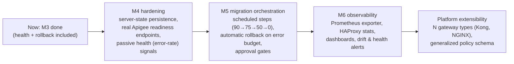

Priority order: (1) commit M3; (2) data-plane restart persistence; (3) real
readiness endpoints; (4) identity + TLS for the API; (5) metrics; (6)
orchestrated migrations with automatic rollback triggers.

---

## 15. Glossary

| Term | Meaning here |
|---|---|
| **Data plane** | HAProxy: handles every API request |
| **Control plane** | The traffic manager: changes HAProxy's runtime state; never handles API requests |
| **Runtime API** | HAProxy's admin command interface over a socket (`show …`, `set server …`, `add/del server`) |
| **Pool** | All runtime endpoints of one platform (OPDK or Hybrid); one HAProxy backend |
| **Pool link / selector** | `traffic_policy/opdk` and `traffic_policy/hybrid`: the tier-1 servers that carry the policy weights |
| **Policy** | The OPDK:Hybrid percentage split; versioned in SQLite |
| **Instance** | One gateway endpoint (router / ingress); one HAProxy dynamic server |
| **Routable** | Enabled ∧ HEALTHY (monitor) ∧ READY (admin) ∧ UP (native check) |
| **READY / MAINT / DRAIN** | HAProxy admin states: in rotation / out of rotation / finishing existing sessions only |
| **Reconcile** | Make HAProxy match the desired state in SQLite |
| **Drift** | Runtime differs from desired state (`in_sync: false`) |
| **Fresh probe** | A successful health probe after a server was (re)added, required before READY |
| **Pool hold** | Temporarily keeping both pool links out of rotation after an HAProxy restart so they return together |
| **abns@** | Abstract-namespace Unix socket used for the in-process hop between HAProxy tiers |
