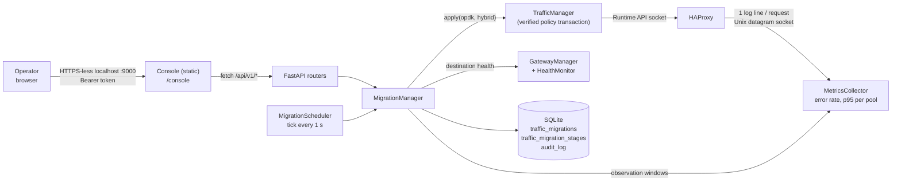
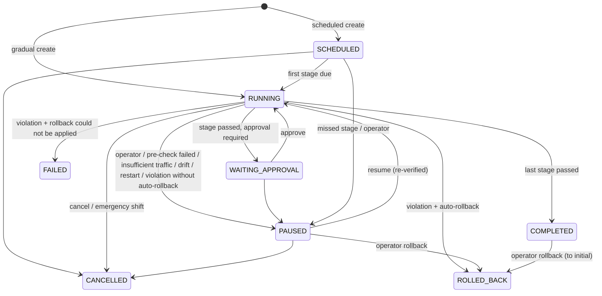

# Traffic Shift Management

The Traffic Shift module of the **Gateway Operations Console** manages gradual,
controlled migration of API traffic between **Apigee OPDK** and **Apigee Hybrid**.

* Console: **http://localhost:9000/console/** (sign in with `TRAFFIC_API_TOKEN`)
* API: `/api/v1/migrations*`, `/api/v1/traffic/emergency`, `/api/v1/metrics/*`,
  `/api/v1/traffic-shift/overview` (all bearer-token protected)

> A passing health check is **not** proof of API compatibility. Every stage is
> also gated on the error rate and latency of real traffic observed through
> HAProxy. Compatibility of API proxies still needs separate validation.

## 1. Architecture

* **The console never talks to HAProxy.** It is a static page (HTML, JS, CSS, no
  build step, no dependencies) that calls the authenticated API. It holds no
  data: every value is fetched live.
* **The migration engine never talks to HAProxy either.** Every allocation
  change goes through `TrafficManager.apply()`, the same verified transaction
  used by manual changes: validation, eligibility, increase-first ordering,
  read-back, rollback, a policy version and an audit record.
* **Metrics are real.** HAProxy's two pool frontends stream one compact line per
  proxied request (`M <pool> <server> <status> <Tr> <Tt>`) to a Unix datagram
  socket that the traffic manager creates on the shared runtime volume
  (mode 600, uid 99, no network listener). The collector computes per-pool
  request count, errors (HTTP 5xx or no response), error rate, and p95/average
  response time (`Tr`). It is fire-and-forget: if the traffic manager is down,
  HAProxy drops the lines and routing is unaffected.

## 2. Modes

| Mode | What it does | API |
|---|---|---|
| **Manual** | Operator sets OPDK % and Hybrid % (total must be 100). Applied immediately. **Pauses** any active migration. | `PUT /api/v1/traffic/config` (existing) |
| **Gradual** | Source → destination in `step_percent` increments, each observed for `interval_seconds`. Start / pause / resume / approve / cancel / roll back. | `POST /api/v1/migrations` (+ `/preview`) |
| **Scheduled** | Explicit future stages (`at`, allocation). Displayed as a schedule; pending stages can be cancelled before execution. | `POST /api/v1/migrations/scheduled`, `DELETE /api/v1/migrations/{id}/stages/{seq}` |
| **Emergency** | Immediate reallocation. Requires a reason and the exact confirmation text `EMERGENCY SHIFT`. Destination availability is validated. Cancels any active migration. Audited as `TRAFFIC_EMERGENCY_SHIFT`. | `POST /api/v1/traffic/emergency` |

Example gradual progression (start 100:0, target 0:100, increment 10, interval 300 s):
`100:0 → 90:10 → 80:20 → 70:30 → 60:40 → 50:50 → 40:60 → 30:70 → 20:80 → 10:90 → 0:100`.
`POST /api/v1/migrations/preview` returns it without starting anything.

## 3. Configuration

| Field | Default | Meaning |
|---|---|---|
| `source`, `destination` | OPDK → Hybrid | Pools; must differ. Either direction is allowed. |
| `start_destination_percent` | current policy | Starting allocation (applied as stage 1 if it differs). |
| `target_destination_percent` | 100 | Final destination share. |
| `step_percent` | 10 | Percentage points per stage (the last step clamps to the target). |
| `interval_seconds` | 300 | Observation window per stage = time between steps. |
| `min_requests` | 100 | Minimum destination-pool requests in a window. Fewer → **PAUSED** (insufficient evidence). |
| `max_error_rate_percent` | 1.0 | Destination-pool error rate limit. |
| `max_p95_ms` | 1000 | Destination-pool p95 response-time limit. |
| `min_healthy_instances` | 1 | Routable destination instances required. |
| `auto_rollback` | true | On a violation, re-apply the last known-good allocation. |
| `require_approval` | false | Wait for `POST /approve` between stages. |
| Scheduled only: `stages[]` (`at` with timezone, `opdk_weight`, `hybrid_weight`), `final_observation_seconds` | | |

## 4. Safety model

**Before each stage** (failure → PAUSED, nothing applied):
1. The HAProxy runtime policy still equals the allocation the migration last
   applied. If anyone changed it out-of-band, the migration pauses and never
   overwrites it.
2. The destination pool has at least `min_healthy_instances` routable instances.

**During observation (every second):** destination health is re-checked. A drop
below the minimum is an immediate violation, without waiting for the window to end.

**At the end of each window**, over the destination pool's real traffic:
* requests ≥ `min_requests`, otherwise PAUSED (not enough evidence to proceed);
* error rate ≤ `max_error_rate_percent` and p95 ≤ `max_p95_ms`, otherwise a **violation**.

**Violation:** the stage is marked FAILED with its metrics. With
`auto_rollback` the last known-good allocation is re-applied → **ROLLED_BACK**
(→ **FAILED** if that rollback itself cannot be applied). Without it the
migration is **PAUSED** with the reason recorded.

**Last known-good** is the allocation of the last stage that *passed*
observation (initially the starting policy).

**One migration at a time:** an in-process lock, plus a `UNIQUE active_slot`
column in SQLite so even concurrent requests cannot create two active
migrations (8 simultaneous starts → one 201, seven 409s, tested).

**Restart safety:** migration state is persisted in SQLite, but observation
windows live in memory. After a service restart, RUNNING and WAITING_APPROVAL
migrations become **PAUSED** ("observation data was lost"). **Resume**
re-checks that the actual HAProxy policy equals the migration's allocation and
that the destination is healthy, then starts a *fresh* window. Scheduled stages
missed while the service was down (more than `SCHEDULE_GRACE_SECONDS`, default
60 s, late) are **never executed late**. The migration pauses, and on resume
the missed stages are skipped.

**Manual changes win.** A manual policy change or rollback through the API
pauses an active migration. An emergency shift cancels it.

## 5. Persistence (migration `0002`)

`traffic_migrations`: id, name, mode, source/destination, initial / target /
current / last-good allocation, step, interval, thresholds, auto-rollback,
approval, status + reason, current stage, next action time, `active_slot`,
created_by, created / updated / finished timestamps.

`traffic_migration_stages`: seq, planned allocation, scheduled time, status
(PENDING / APPLIED / PASSED / FAILED / CANCELLED), applied / observation-start /
completed times, **actual allocation read back from HAProxy**, the policy version
it created, **safety-check results** (pre-stage and window), **metrics** (both
pools: requests, errors, error rate, p95, avg), reason.

Audit events (entity `migration`): `MIGRATION_CREATED`, `MIGRATION_STAGE`,
`MIGRATION_PAUSED`, `MIGRATION_RESUMED`, `MIGRATION_APPROVED`,
`MIGRATION_CANCELLED`, `MIGRATION_ROLLBACK`, `MIGRATION_COMPLETED`,
`MIGRATION_FAILED`, plus `TRAFFIC_EMERGENCY_SHIFT`. Each stage's policy change is
also a normal versioned `TRAFFIC_POLICY_CHANGE` with `updated_by =
migration:<id>`.

## 6. Console

| Tab | Content |
|---|---|
| **Dashboard** | Live OPDK / Hybrid % (read from HAProxy), target allocation, migration stage x/y, progress, status, last successful shift. Gateway health per pool (routable/healthy/unhealthy, configured vs effective share). Requests, req/s, error rate, p95, avg per pool (last 60 s). Active migration with controls and a stage table. Charts: allocation over time (policy versions), error rate and p95 by pool (15 min, 15 s buckets). |
| **Manual shift** | Linked OPDK/Hybrid inputs (total enforced at 100), allocation bar, reason. |
| **Gradual shift** | Direction, start/target/increment/interval, all safety gates, *Preview stages*, *Start*. |
| **Scheduled shift** | Stage editor (local time → UTC), safety gates, schedule view with per-stage cancel. |
| **Emergency** | One-click "all to OPDK / all to Hybrid" or custom; live destination availability; reason; confirmation dialog requiring `EMERGENCY SHIFT`. |
| **History** | Migrations list → planned vs actual allocation chart per stage (failed stages marked), stage table (time, allocation, error rate, p95, status), migration audit trail; full traffic-policy history. |

Charts follow the project's data-viz rules: validated palette (OPDK = blue,
Hybrid = orange, light and dark steps), one y-axis per chart (error rate and
latency are separate charts), 2px lines, legends plus collision-free direct
labels, a crosshair tooltip listing every series (mouse and arrow keys), and a
table view for every chart. Status is always icon + label, never color alone.

Security: strict Content-Security-Policy (`script-src 'self'`, no inline
script or style), `no-store`, `frame-ancestors 'none'`. The token lives only in
`sessionStorage` for the tab, and all API data is inserted as text nodes.

## 7. Validation

| Layer | Tests | Result |
|---|---|---|
| Unit (fake HAProxy, fake clock shared by engine and metrics) | `test_migrations.py` (26), `test_console_metrics.py` (13), +13 auth cases | 139/139 passing overall |
| Live API (real HAProxy, real metric stream, background load) | `tests_integration/test_live_migrations.py` (8) | 8/8 in two consecutive runs (one earlier run had a single unexplained timeout, not reproduced since) |
| Real browser (headless Chrome over DevTools) | sign in → preview → start gradual → duplicate-start blocked in UI → dashboard mid-migration → tooltip → completion → history → emergency dialog (wrong text rejected, correct text applied) → dark mode | all steps passed; no JS exceptions or CSP violations |
| Regression | `test_live.py` (16), Milestone 2 suite (9) | all passing |

Live evidence (from the runs):
* Gradual 100:0 → 50:50 → 0:100 at 4 s windows completed with 4,400–4,600 and
  6,900–8,500 real Hybrid requests evaluated per stage, 0% errors.
* With Hybrid simulators returning 5xx on ~30% of API calls **while their
  readiness checks stayed HEALTHY**, the migration observed 27.8–31.9% errors
  over 733–890 requests and automatically rolled back to 100:0.
* With 300 ms injected latency and `auto_rollback=false`, the migration paused
  at 90:10 (p95 > 200 ms), and an operator rollback restored 100:0.

## 8. Limitations

* **Observation data is in memory** (bounded deque per pool,
  `METRICS_RETENTION_SECONDS`, default 900). It is lost on restart, which is why
  in-flight migrations pause. Per-stage results are persisted.
* **Metrics are per pool, from HAProxy's view** (`Tr` = time to response
  headers). They don't separate API proxies, consumers or paths, and a 4xx is
  not counted as an error.
* **Latency is p95 over the window** using nearest rank. Very low traffic
  makes p95 noisy; use `min_requests` to require enough evidence.
* **Single process.** The engine lock is per process (run one Uvicorn worker).
* The console's charts show the last 40 policy versions and 15 minutes of
  metrics; long-term trends need an external metrics system (Milestone 6).
* **Authentication is the shared admin token** (see `architecture.md` §7).
